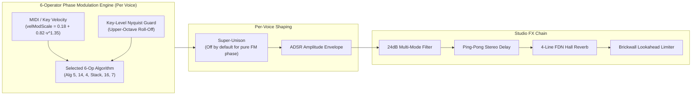

# 80s FM Piano Synth v0.1 (`fmpianos.html`)

An expressive, browser-based polyphonic **6-Operator Phase-Modulation (FM) Piano Synthesizer** dedicated to the crystalline electric pianos, bell-like chimes, barking reeds, lush ballad stacks, and percussive clavs that defined 1980s pop, soul, R&B, and soundtrack music.

- **Application Entry Point**: [`fmpianos.html`](fmpianos.html)
- **Bootstrap & UI Wiring**: [`synths/fmpianos/app.js`](synths/fmpianos/app.js)
- **Factory Presets**: [`synths/fmpianos/presets.js`](synths/fmpianos/presets.js)
- **Sound Engines**: [`synths/fmpianos/engines/`](synths/fmpianos/engines/)
- **General Platform Documentation**: [`README.md`](README.md)

---

## Table of Contents

1. [Part 1: Guide for Musicians & Everyday Listeners (Non-Specialists)](#part-1-guide-for-musicians--everyday-listeners-non-specialists)
2. [Part 2: Guide for Sound Designers & Music Producers](#part-2-guide-for-sound-designers--music-producers)
3. [Part 3: Deep-Dive Mathematics & DSP Engineering](#part-3-deep-dive-mathematics--dsp-engineering)
4. [Credits, Research Papers & Historical Sources](#credits-research-papers--historical-sources)

---

## Part 1: Guide for Musicians & Everyday Listeners (Non-Specialists)

### What Is an "80s FM Piano" and Why Did It Change Music?

Before the 1980s, electric pianos were heavy electromechanical instruments Weighing over 100 pounds. Inside them, small felt or neoprene hammers physically struck metal rods (**tines**) or flat steel tongues (**reeds**) next to magnetic pickups—much like an electric guitar combined with a grand piano.

In 1983, a new kind of digital keyboard revolutionized music. Instead of using physical hammers or recorded audio samples, it generated sound purely from mathematics using a technique called **Frequency Modulation (FM)**. Suddenly, producers could create electric piano sounds that were brighter, clearer, and more glass-like than any physical instrument could ever be. That shimmering, bell-like electric piano became the signature sound of 1980s love ballads, slow dances, and pop anthems.

### How Does FM Synthesis Work (Without the Math)?

Imagine two singers standing on a stage:
1. **The Carrier (The Singer You Hear)**: One singer holds a pure, smooth note—like humming a single flute-like pitch. By itself, it sounds very plain.
2. **The Modulator (The Influencer)**: The second singer doesn't sing into the microphone. Instead, they rapidly nudge the first singer's pitch back and forth hundreds or thousands of times per second.

When you nudge a pure tone that fast, the human ear no longer hears a wobble in pitch—instead, it hears a **brand-new texture** full of metallic, woody, or bell-like overtones:
- If the Influencer nudges the Singer **gently**, the sound becomes warm and mellow, like a softly played electric piano.
- If the Influencer nudges the Singer **hard** right when you press a key—and then quickly calms down—you hear the unmistakable **"chime"** of a hammer striking a metal tine, followed by a warm, singing sustain.
- If the Influencer sings at **14 times** the pitch of the Singer, it creates a sparkling, diamond-like bell chime on top of the note.

### Why Is This Synthesizer Easy to Play?

Traditional 1980s FM synthesizers were notoriously difficult to program. They hid hundreds of numbers behind tiny LCD screens, requiring musicians to adjust 6 separate "operators" (oscillators) across 32 wiring diagrams ("algorithms").

**80s FM Piano Synth v0.1** uses that exact same 6-operator digital sound engine under the hood, but replaces the cryptic numbers with **4 intuitive musical controls per mode**:
- Want more sparkle on the attack? Turn up **Tine Chime** or **Bell Glass**.
- Want the note to growl when you hit the keys hard? Turn up **FM Bark** or **Reed Bite**.
- Want a softer, dreamier sound for a slow ballad? Turn up **Bell Roundness** or **Velvet Softness**.

### Meet the 6 Piano Modes

| Mode | Musical Character | What It Feels Like to Play |
| :--- | :--- | :--- |
| **1. Classic Tine E.Piano** | The quintessential 1980s love-ballad electric piano. | Soft notes purr with a warm, rounded tone; hard notes ring out with a crystal bell chime and a gentle mid-range "bark." |
| **2. Crystal Bell & Celeste** | Sparkling music boxes, tubular bells, and icy holiday chimes layered over a warm piano bed. | Shimmering, glassy, and crystalline. You can morph the bell from a soft round celeste to a bright diamond chime. |
| **3. Barking Reed E.Piano** | Punchy, soulful, and slightly gritty reed electric piano with stereo vibrato. | Responds with a woody, nasal "bite" when played hard—ideal for rhythm & blues, soul, and pop grooves. |
| **4. Stereo Ballad Stack** | The huge, wide "Los Angeles studio rack" sound heard on biggest 80s soundtrack hits. | Sounds like several electric pianos and bell modules layered together in wide stereo—rich, larger-than-life, and glossy. |
| **5. Soft Rounded Ballad EP** | Pillowy, velvety electric piano where the upper harmonics gently "bloom" *after* you press the key. | Zero harshness on the attack; notes swell like a warm cloud—made for intimate intros and ambient ballads. |
| **6. Sharp Electric Grand & Clav** | Snappy, percussive keyboard sounds ranging from an electric grand piano to a funky clavinet or wooden marimba. | Crisp, rhythmic, and articulate, with tight dampers that make fast riffs pop. |

---

## Part 2: Guide for Sound Designers & Music Producers

### Signal Architecture & Design Philosophy



#### Key Sound-Design Principles in `fmpianos.html`
1. **Pure Phase Coherency by Default (`unisonEnabled: false`)**:
   Authentic 1980s FM electric pianos derive their crystalline transient snap from instantaneous phase modulation between locked operators. Multi-voice unison detuning smears those fast phase transients, so **Super-Unison** (`unisonEnabled: false`, `subLevel: 0.0`) and **Wavefolder / Vector Chorus** (`driveAmount: 0.0`, `chorusMix: 0.0`) are disabled across 17 of the 18 factory presets—leaving only clean stereo operator phase spread, subtle Ping-Pong Delay, and lush FDN Hall Reverb. (Only preset #15, *"🌌 1986 Prom Night Slow-Dance Pad EP"*, enables 3-voice Super-Unison for a thick synth-pad layer.)
2. **Expressive Intermediate Velocity Curve**:
   FM pianos are defined by **timbral velocity response**, not just volume changes. In this synth:
   - Incoming MIDI velocity $v_{\text{midi}} \in [1, 127]$ maps to normalized velocity via $v = 0.12 + 0.88 \cdot (v_{\text{midi}}/127)^{1.45}$.
   - Inside every FM engine, $v$ scales the **Modulation Index** ($I_m$) via `velModScale = 0.18 + 0.82 * Math.pow(vel, 1.35)` across **16 discrete velocity layers**.
   - Playing *pianissimo* ($pp$) lowers $I_m$ toward a pure sine carrier; playing *fortissimo* ($ff$) drives $I_m$ into rich upper Bessel sidebands (tine chime and reed bark).

---

### Mode-by-Mode Macro Controls & Sound Design Recipes

#### Mode 1: Classic Tine E.Piano (`dx7_epiano1` — Algorithm 5)
- **Topology**: Three parallel 2-operator stacks:
  - **Branch A (`Op2[fb] → Op1`, Ratio `1:1`)**: Warm electric piano body and velocity-driven mid-range bark.
  - **Branch B (`Op4 → Op3`, Ratio `14:1`)**: High-ratio crystal tine bell chime with automatic upper-octave key scaling.
  - **Branch C (`Op6 → Op5`, Ratio `9:2`)**: Ultra-fast ($18\text{ ms}$) mechanical hammer key-click transient.
- **Controls**:
  - **Tine Chime (`tineChime`)**: Controls both the modulation index of `Op4` ($14\times$) and the carrier mix of `Op3`. Higher values bring out the glassy 14th-harmonic bell ring.
  - **FM Bark (`fmBark`)**: Controls the modulation index and self-feedback of `Op2` ($1\times$). Low values yield a round, pure sine body; high values add gritty harmonic growl on hard key strikes.
  - **Hammer Click (`hammerClick`)**: Controls the transient burst of `Op6 → Op5` during the first $35\text{ ms}$ of the note.
  - **Tine Decay (`tineDecay`)**: Adjusts the exponential decay time constant of both `Op2` and `Op4` modulators ($60\text{ ms}$ to $300\text{ ms}$).
  - **Interactive 2D Algorithm 5 Canvas**: Drag horizontally to sweep **Tine Chime** and vertically to sweep **FM Bark** in real time.

#### Mode 2: 80s Crystal Bell & Celeste (`fm_crystal_bell` — Algorithm 14)
- **Topology**: A 3-operator cascaded bell tower (`Op6 → Op5 → Op3`) layered over a warm 2-operator electric piano body (`Op2 → Op1`).
- **Controls**:
  - **Bell Ratio (`bellRatio` + Selector)**: Tunes the `Op5` modulator ratio relative to the carrier:
    - `2.0:1` (Warm Octave Bell)
    - `3.5:1` (Inharmonic Tubular Chime)
    - `5.0:1` (Glassy Fifth Bell)
    - `7.0:1` (Classic 80s Celeste)
    - `11.0:1` (Metallic Music Box)
    - `14.0:1` (Diamond High Tine)
  - **Bell Roundness (`bellRoundness`)**: Attenuates the peak modulation index $I_5$ ($1 - 0.78 \cdot \text{roundness}$) and lengthens modulator decay, transforming sharp metallic bells into soft, rounded celestes.
  - **Cascade Halo (`cascadeShimmer`)**: Drives `Op6` ($2\times$) into `Op5`, creating compound sideband halos around the bell partial.
  - **Warm Body (`warmPadMix`)**: Blends the `1:1` (`Op2 → Op1`) warm electric piano foundation underneath the bell tower.

#### Mode 3: Barking Reed E.Piano (`fm_wurli_reed` — Algorithm 4)
- **Topology**: Dual 3-operator cascades:
  - **Stack A (`Op3[3x] → Op2[2x] → Op1[1x]`)**: Combines `2:1` and `3:1` modulator ratios to generate the odd-harmonic asymmetry and hollow bark of a vibrating steel reed.
  - **Stack B (`Op6[5x+fb] → Op5[1x] → Op4[1x]`)**: Adds mechanical reed hammer chiff and warm wooden cabinet resonance.
- **Controls**:
  - **Reed Bite (`reedBite`)**: Scales the velocity-sensitive `2:1` modulation index (`Op2 → Op1`) for aggressive soul/R&B growl.
  - **Reed Buzz (`reedBuzz`)**: Increases the `3:1` upper modulator (`Op3`) and `Op6` self-feedback for nasal harmonic buzz.
  - **Vibrato Depth (`tremoloDepth`)**: Controls the built-in phase-locked stereo pan tremolo/vibrato modulator.
  - **Wood Body (`woodBody`)**: Balances the warm `1:1` Stack B cabinet foundation against the biting reed stack.

#### Mode 4: Stereo Ballad Stack (`fm_tx816_stack` — Multi-Rack Layer)
- **Topology**: Simulates multiple detuned FM rack modules panned across the stereo field:
  - **Module A**: Warm `1:1` + `2:1` electric piano body with feedback.
  - **Module B**: Dual-tier `7:1` and `14:1` glassy tine chimes panned in wide stereo opposition.
  - **Module C**: Fast `4:2` ($22\text{ ms}$) acoustic-electric hammer snap.
- **Controls**:
  - **Rack Stereo (`stackSpread`)**: Widens the quadrature phase offset between Left and Right rack channels (`4%` to `24%` of a wave cycle).
  - **Bell Glass (`fosterGlass`)**: Boosts both the `7:1` and `14:1` crystal tine modulators for the signature 1980s L.A. studio ballad sheen.
  - **Ballad Warmth (`balladWarmth`)**: Thickens the `1:1` and `2:1` mid-bass body foundation.
  - **Hammer Snap (`attackSnap`)**: Adds a crisp electric-grand pick/hammer transient on note onset.

#### Mode 5: Soft Rounded Ballad EP & Dream Pad (`fm_lush_pad_ep` — Algorithm 16)
- **Topology**: Multiple parallel modulators (`1x`, `2x`, `3x`, `4x`, `6x`) converging onto a single pillowy carrier (`Op1`), accompanied by a sub-octave (`0.5x`) velvet pad layer.
- **Controls**:
  - **Velvet Softness (`toneSoftness`)**: Compresses upper Bessel sidebands so even hard key strikes remain warm and rounded.
  - **Bell Bloom (`bellBloom`)**: Introduces an exponential **attack swell** ($\tau_{\text{attack}} = 85\text{ ms}$) on the `2:1` and `3:1` modulators so upper overtones gently blossom *after* the key strike.
  - **Sub Warmth (`subWarmth`)**: Mixes in the phase-modulated `0.5x` sub-octave velvet pad foundation.
  - **Air Halo (`airHalo`)**: Controls the `4:1` (Left) and `6:1` (Right) stereo upper harmonic shimmer.

#### Mode 6: Sharp Electric Grand, Clav & Mallet (`fm_perc_clav` — Algorithm 7)
- **Topology**: High-velocity transient cascade (`Op6[fb] → Op5[R] → Op3[1x]`) paired with a `2:1` string body (`Op2 → Op1`).
- **Controls**:
  - **Attack Bite (`attackSharpness`)**: Drives peak transient modulation index up to $3.75\text{ rad}$ for snappy pick/hammer articulation.
  - **Hollow Ratio (`hollowRatio`)**: Sweeps the `Op5` modulator ratio from `1.0` to `8.0`:
    - `2.0:1`: Electric Grand Piano string timbre
    - `3.0:1`: Hollow odd-harmonic FM Clavinet / Rosewood Marimba
    - `4.0:1`: Bright funky Clavinet pick
    - `6.0:1`: Metallic Harpsichord / Vibraphone mallet
  - **String Edge (`stringBrilliance`)**: Adjusts `Op6` feedback and steady-state string brilliance.
  - **Damper Decay (`damperTightness`)**: Shortens the modulator decay time constant down to $25\text{ ms}$ for staccato funk clavinet playing or opens it up to $135\text{ ms}$ for ringing electric grand chords.

---

## Part 3: Deep-Dive Mathematics & DSP Engineering

### 1. Phase Modulation (PM) vs. Frequency Modulation (FM)

Although popularized under the name "FM Synthesis" by John Chowning (1973), the hardware architecture of 1980s 6-operator synthesizers (such as the Yamaha YM21280 OPS chip) actually computes **Digital Phase Modulation (PM)**.

For a 2-operator modulator-carrier pair with fundamental frequency $f_0$, integer or fractional frequency ratios $R_c, R_m$, time-varying envelopes $A_c(t), I_m(t)$, and modulator self-feedback $\beta_{\text{fb}}$, the discrete-time signal at sample $n$ ($t = n / f_s$) is:

$$\phi_m[n] = \left(\phi_m[n-1] + \frac{2\pi R_m f_0}{f_s}\right) \bmod 2\pi$$

$$y_m[n] = \sin\Big(\phi_m[n] + \beta_{\text{fb}} \, y_m[n-1]\Big)$$

$$y_c[n] = A_c[n] \sin\Big(\phi_c[n] + I_m[n, v] \, y_m[n]\Big)$$

#### Why Phase Modulation Is Numerically Superior for Polyphonic Pianos
In true frequency modulation, any slight DC offset or non-zero mean in a self-modulated feedback operator ($\beta_{\text{fb}} > 0$) integrates over time ($\int \Delta f \, dt$), causing the carrier pitch to drift out of tune. Because Phase Modulation adds $I_m[n] y_m[n]$ directly to the instantaneous **phase angle** $\phi_c[n]$ outside the phase accumulator, **pitch drift is mathematically impossible** regardless of modulation index $I_m$ or feedback depth $\beta_{\text{fb}}$.

---

### 2. Jacobi-Anger Identity & Bessel Function Sideband Spectrum

Expanding the phase-modulated carrier $y_c(t) = A_c \sin(\omega_c t + I_m \sin(\omega_m t))$ via the **Jacobi-Anger identity** yields an infinite series of discrete sidebands weighted by **Bessel functions of the first kind** $J_k(I_m)$:

$$\sin\big(\omega_c t + I_m \sin(\omega_m t)\big) = \sum_{k=-\infty}^{\infty} J_k(I_m) \sin\big((\omega_c + k \omega_m) t\big)$$

Using the symmetry $J_{-k}(I_m) = (-1)^k J_k(I_m)$, the acoustic spectrum consists of partial frequencies:

$$f_k = \big| R_c \pm k R_m \big| f_0, \quad k \in \{0, 1, 2, \dots\}$$

with spectral amplitudes proportional to $|J_k(I_m)|$:
- **At $I_m = 0$**: $J_0(0) = 1$ and $J_k(0) = 0$ for all $k \ge 1$. Only the pure sinusoidal carrier $R_c f_0$ is present.
- **As $I_m$ increases with key velocity**: Energy transfers from the fundamental $J_0(I_m)$ into higher-order sidebands $J_1(I_m), J_2(I_m), \dots, J_M(I_m)$ up to Carson's bandwidth rule $k_{\max} \approx \lceil I_m + 1 \rceil$.
- **Reflected Negative Frequencies**: When $k R_m > R_c$, the negative sideband $f_0(R_c - k R_m) < 0$ reflects around $0\text{ Hz}$ with a $\pi$ phase inversion ($\sin(-\theta) = -\sin(\theta)$), interlocking with positive harmonics to create the characteristic hollow/woody interference of FM electric pianos.

#### Cascaded 3-Operator FM (Modes 2, 3, 6)
When Operator 6 modulates Operator 5, which in turn modulates Carrier Operator 3 (`Op6 → Op5 → Op3` in Algorithm 14), the output spectrum follows a **double Bessel expansion**:

$$y_3(t) = \sum_{k=-\infty}^{\infty} \sum_{m=-\infty}^{\infty} J_k(I_5) \, J_m(k \, I_6) \sin\Big(\big(\omega_3 + k \omega_5 + m \omega_6\big) t\Big)$$

This produces dense clusters of secondary sidebands around each primary bell partial $R_3 \pm k R_5$, giving Mode 2 (`fm_crystal_bell`) its shimmering "halo" without requiring additional oscillators.

---

### 3. Algorithm Topologies & Ratio Mathematics Across the 6 Engines

| Engine / Mode | Algorithm | Operator Graph | Frequency Ratios $(R_1, R_2, R_3, R_4, R_5, R_6)$ | Acoustic Role of Ratios |
| :--- | :--- | :--- | :--- | :--- |
| **Mode 1 (`dx7_epiano1`)** | **Alg 5** | `[Op2(fb)→Op1] + [Op4→Op3] + [Op6→Op5]` | $(1, \, 1, \, 1, \, 14, \, 2, \, 9)$ | `1:1` produces all integer harmonics ($1f_0, 2f_0, 3f_0\dots$) for warm body; `14:1` places sidebands at $1f_0 \pm 14k f_0$ ($13f_0, 15f_0, 27f_0, 29f_0$) mimicking high-order transverse modes of a struck steel tine; `9:2` adds an inharmonic key-click transient. |
| **Mode 2 (`fm_crystal_bell`)** | **Alg 14** | `[Op6→Op5→Op3] + [Op2→Op1]` | $(1, \, 1, \, 1, \, -, \, R_{\text{bell}}, \, 2)$ | $R_{\text{bell}} \in [1.0, 14.0]$ (quantized to $0.5$ steps for loop phase-locking); half-integer ratios like $3.5:1$ generate octave-spaced inharmonic bell partials. |
| **Mode 3 (`fm_wurli_reed`)** | **Alg 4** | `[Op3→Op2→Op1] + [Op6(fb)→Op5→Op4]` | $(1, \, 2, \, 3, \, 1, \, 1, \, 5)$ | Modulating a `1:1` carrier with `2:1` creates predominantly **odd harmonics** ($1 \pm 2k \implies 1, 3, 5, 7\dots$), reproducing the square/hollow spectrum of a clamped steel reed. |
| **Mode 4 (`fm_tx816_stack`)** | **Multi-Rack** | `Body(1x,2x) + Glass(7x,14x) + Snap(4x→2x)` | $(1, \, 2, \, 4, \, 7, \, 14)$ | Simultaneous `7:1` and `14:1` modulators create dual octave-locked crystal tine tiers across a wide quadrature-shifted stereo field. |
| **Mode 5 (`fm_lush_pad_ep`)** | **Alg 16** | `(Op2+Op3+Op4+Op6) → Op1 + Sub(0.5x)` | $(0.5, \, 1, \, 2, \, 3, \, 4, \, 6)$ | Attack-Retention envelope $E_{\text{bloom}}[n] = 1 - e^{-n / (\tau_a f_s)}$ causes `2x/3x/6x` sidebands to swell *after* note onset. |
| **Mode 6 (`fm_perc_clav`)** | **Alg 7** | `[Op6(fb)→Op5→Op3] + [Op2→Op1]` | $(1, \, 2, \, 1, \, -, \, R_h, \, R_h+1)$ | $R_h \in [1.0, 8.0]$ selects hollow clavinet ($3:1$), electric grand ($2:1$), or metallic mallet ($6:1$) transient spectra. |

---

### 4. Real-Time DSP Optimizations in JavaScript

To achieve **$< 0.8\text{ ms}$ per-voice buffer synthesis** with zero garbage collection or audio thread dropouts:

1. **Shared 4096-Point Integer Bitmask Sine Lookup Table (`DX7_SIN_TABLE`)**:
   Instead of calling `Math.sin()` six times per sample (which would require $>220,000$ transcendental calls per voice), all 6 engines share a precomputed `Float32Array(4096)` table (`TABLE_MASK = 4095`). Phase accumulators and phase-modulation offsets operate directly in table-index units (`RAD_TO_IDX = 4096 / (2 * Math.PI)`), reducing each operator evaluation to a single bitwise mask:
   ```js
   const opOut = SIN_TABLE[(phase + modOffset) & 4095];
   ```
2. **Upper-Octave Nyquist Key Scaling (`nyquistGuard`)**:
   High-ratio modulators such as $14:1$ exceed the Nyquist limit ($f_s / 2$) on high notes (e.g., at $f_0 = 1046\text{ Hz}$ [C6], $14 f_0 = 14,644\text{ Hz}$, and its 2nd Bessel sideband reaches $29,288\text{ Hz} > f_s/2$), which would fold back as harsh digital aliasing. Just as hardware FM synthesizers use **Keyboard Level Scaling (R-Scale)** curves, our engines attenuate high-ratio modulation indices smoothly with pitch:
   $$G_{\text{Nyquist}}(f_0) = \begin{cases} \dfrac{1}{1 + (f_0 / f_{\text{knee}})^{1.8}}, & R_m f_0 < 0.43 f_s \\ 0, & \text{otherwise} \end{cases}$$
3. **Phase-Locked Sustain Loop & Raised-Cosine Crossfade Splice**:
   Each generated `0.85s` stereo `AudioBuffer` computes the exact transient evolution over the first `0.30s` (`freezeSample`), then freezes modulator envelope decay at steady-state floor indices $(I_{\text{floor}})$ over an exact integer number of fundamental cycles $N_{\text{periods}}$ (`loopStartSample = 0.42s` to `loopEndSample`).
   - The fundamental phase step is locked to $\Delta \phi = \frac{4096 \cdot N_{\text{periods}}}{N_{\text{loopSamples}}}$ so every integer and half-integer operator ratio completes an exact integer number of cycles across the loop window.
   - A raised-cosine window $w[i] = \frac{1}{2}\big(1 - \cos(\frac{\pi (i+1)}{N_{\text{xfade}}})\big)$ crossfades the end of the loop with the pre-loop region (`loopStartSample - xfadeSamples`), guaranteeing **zero click or phase discontinuity** when sustained indefinitely, while the per-voice `EnvelopeModule` ADSR controls the macroscopic decay and release.

---

## Credits, Research Papers & Historical Sources

1. **Chowning, John M. (1973)** — *"The Synthesis of Complex Audio Spectra by Means of Frequency Modulation"*, Journal of the Audio Engineering Society (JAES), Vol. 21, No. 7, pp. 526–534. (Foundational paper introducing carrier/modulator ratios, Bessel function sideband spectra, and dynamic modulation index envelopes for brass, woodwind, and percussive bell/piano timbres.)
2. **Chowning, John M. & Bristow, Dean (1986)** — *FM Theory & Applications: By Musicians for Musicians*, Yamaha Music Foundation, Tokyo, ISBN 4-636-17482-8. (Classic reference detailing multi-operator algorithm topologies, parallel vs. cascaded stacks, operator self-feedback, and keyboard level scaling for electric pianos.)
3. **Yamaha Corporation (1983–1985)** — *YM21280 OPS (Operator Type-S) & DX7 / TX816 Digital Programmable Algorithm Synthesizer Service & Programming Manuals*. (Hardware reference for 6-operator phase-modulation lookup tables, Algorithm 4, 5, 7, 14, and 16 routing graphs, and multi-module stereo rack layering.)
4. **Gauthier, Pascal et al.** — *Dexed: FM Plugin Synth* (Open-Source GPLv3 multi-platform 6-operator FM synthesizer engine modeled closely on the original OPL/OPS digital phase-modulation math).
5. **Schottstaedt, Bill (1977)** — *"The Simulation of Natural Instrument Tones Using Frequency Modulation with a Complex Modulating Wave"*, Computer Music Journal, Vol. 1, No. 4, pp. 46–50. (Mathematical analysis of multi-modulator and cascaded FM spectra.)
