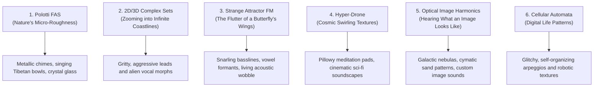

# Fractal Sound Engine V2 (`fractalsynths.html`)

A modular, browser-based polyphonic synthesizer driven by mathematical fractals, strange attractor chaos theory, optical spectral resynthesis, and 1D cellular automata. Built entirely in modern JavaScript with the Web Audio API, Canvas 2D/3D graphics, and dynamic DSP parameter reactivity.

- **Application Entry Point**: [`fractalsynths.html`](fractalsynths.html)
- **Bootstrap & UI Wiring**: [`synths/fractal/app.js`](synths/fractal/app.js)
- **Factory Presets**: [`synths/fractal/presets.js`](synths/fractal/presets.js)
- **Sound Engines**: [`synths/fractal/engines/`](synths/fractal/engines/)
- **General Platform Documentation**: [`README.md`](README.md)

---

## Table of Contents

1. [Part 1: Guide for Musicians & Everyday Listeners (Non-Specialists)](#part-1-guide-for-musicians--everyday-listeners-non-specialists)
2. [Part 2: Guide for Sound Designers & Music Producers](#part-2-guide-for-sound-designers--music-producers)
3. [Part 3: Deep-Dive Mathematics & DSP Engineering](#part-3-deep-dive-mathematics--dsp-engineering)
4. [Credits, Research Papers & Academic Sources](#credits-research-papers--academic-sources)

---

## Part 1: Guide for Musicians & Everyday Listeners (Non-Specialists)

### What Is a "Fractal Synthesizer"?

Most traditional synthesizers build sounds from simple geometric shapes like smooth sine waves, buzzing sawteeth, or hollow square waves. These shapes repeat themselves perfectly millions of times. While they sound great for classic synth riffs, real-world sounds—like the crash of ocean surf, the crackle of a campfire, the resonance of a cathedral bell, or the wind rustling through leaves—never repeat in a stiff, sterile way. They contain **intricate, self-similar micro-patterns across multiple scales**.

In mathematics, shapes that look detailed and self-similar no matter how much you zoom in on them are called **fractals**. 

**Fractal Sound Engine V2** uses mathematical equations from nature, chaos theory, and computer science to generate sound waveforms that are organically alive, evolving, and rich in natural texture.

### Intuitive Analogies for the 6 Fractal Modes

1. **Mode 1: Polotti Fractal Additive Synthesis (FAS)**
   - *The Analogy*: Think of a smooth glass marble versus a rough granite stone. When you tap granite, its microscopic rough surface produces complex, non-harmonic overtones. This mode lets you control the "microscopic roughness" (**Fractal Dimension**) and partial spacing of the sound, producing glowing bells, icy crystal chimes, and resonant acoustic-like textures.
2. **Mode 2: 2D & 3D Complex Fractals (Mandelbrot & Julia Sets)**
   - *The Analogy*: Imagine flying an airplane along an infinitely jagged coastline. If your flight path skims the jagged cliffs, your ears hear fierce, biting overtones. If your flight path circles over smooth bays, you hear round, mellow tones. Dragging your mouse across the interactive on-screen map lets you steer that flight path in real time.
3. **Mode 3: Strange Attractor FM (Deterministic Chaos)**
   - *The Analogy*: Think of a double pendulum or the famous "butterfly effect" in weather forecasting. Strange attractors are formulas whose trajectories never settle down and never repeat, yet remain beautifully bounded within a spiral or butterfly shape. We use that chaotic motion to modulate audio frequencies, yielding organic vocal formants, snarling robotic growls, and acoustic instability.
4. **Mode 4: Hyper-Drone**
   - *The Analogy*: An eternal, slowly shifting drone tuned to nature's irrational ratios (such as the Golden Ratio $\phi \approx 1.618$). Because the overtones never line up in simple integer multiples, the sound never creates repetitive beating loops; it swirls through stereo space like a living breathing atmosphere.
5. **Mode 5: Optical Image Harmonics**
   - *The Analogy*: "Hearing a picture." An invisible laser scanner sweeps across a digital canvas (a cosmic nebula, quantum ripple, or an image you drag and drop from your computer). Bright pixels generate high overtones and dark pixels generate low rumbles, allowing you to turn visual art into music.
6. **Mode 6: Wolfram 1D Cellular Automata**
   - *The Analogy*: Simple digital rules creating complex living colonies (like Stephen Wolfram's Rule 30 or Rule 110). A single seed cell on a grid spreads outward, turning harmonic overtones on and off like rhythmic crystalline light patterns.

---

## Part 2: Guide for Sound Designers & Music Producers

### Signal Flow Architecture

```mermaid
flowchart LR
    subgraph Control_Mod ["Performance & Modulation"]
        KEY["Velocity-Sensitive Keyboard / MIDI"]
        ARP["Generative Fractal Arpeggiator"]
        LFO["Context-Aware Modulation LFO"]
    end

    subgraph Voice_Matrix ["Polyphonic Voice Matrix (Up to 32 Voices)"]
        VM["PolyphonicVoiceManager"]
        V1["Voice 1"]
        V2["Voice 2"]
        VN["Voice N..."]
    end

    subgraph Engine_Selection ["Active Fractal Sound Engine"]
        E1["Polotti FAS"]
        E2["Complex Sets"]
        E3["Attractor FM"]
        E4["Hyper-Drone"]
        E5["Optical Image"]
        E6["Cellular Automata"]
    end

    subgraph Voice_Conditioning ["Per-Voice Shaping"]
        UNI["Super-Unison Detune Stack (1–7 Voices)"]
        SUB["Dedicated Sub-Bass Core"]
        ENV["ADSR Amplitude Envelope"]
    end

    subgraph FX_Rack ["Studio Audio FX Pipeline"]
        FLT["24dB Multi-Mode Filter"]
        DRV["Wavefolder & Saturation"]
        CHO["Vector Stereo Chorus"]
        DLY["Ping-Pong Delay"]
        REV["4-Line FDN Reverb"]
        LIM["Brickwall Limiter"]
    end

    Control_Mod --> VM
    VM --> V1 & V2 & VN
    V1 & V2 & VN --> Engine_Selection
    Engine_Selection --> UNI --> SUB --> ENV --> FLT --> DRV --> CHO --> DLY --> REV --> LIM
```

### Parameter Controls & Sound Design Recipes

#### Mode 1: Polotti Fractal Additive Synthesis
- **Gamma Ratio (`fasGamma`, $1.0 - 4.0$)**: The geometric frequency expansion ratio $\gamma$. At $\gamma = 2.0$, partials fall on strict octaves ($1f, 2f, 4f, 8f\dots$). At non-integer values (e.g. $\gamma = 2.15$), partials become inharmonic, generating metallic church bells, gamelan gongs, and glassy vibraphones.
- **Harmonics (`fasHarmonics`, $1 - 16$)**: Number of active fractal partials.
- **Fractal Dimension (`fasDimension`, $1.0 - 1.95$)**: Controls the slope of high-frequency energy. Near $1.0$, the spectrum rolls off steeply for warm, flute-like timbres; near $1.95$, high frequencies stay energetic, creating bright crystalline textures.
- **Spectral Decay (`fasDecay`, $0.10 - 0.95$)**: Sets the power-law attenuation across upper harmonics.
- **fBm Jitter (`fasFbm`, $0\% - 100\%$)**: Injects Fractional Brownian Motion stochastic phase and amplitude perturbations, adding acoustic warmth and organic unpredictability.

#### Mode 2: 2D & 3D Complex Fractals
- **Fractal Set Selector**:
  - `julia`: Smooth, vocal, evolving orbits.
  - `mandelbrot`: Gritty boundary harmonics with biting edge.
  - `burningship`: Aggressive, distorted industrial leads.
  - `newton`: Glassy, tri-polar resonant overtones from 3 complex roots.
  - `mandelbulb3d`: 3D ray-sliced spherical projections.
  - `sierpinski`: Geometric bitwise fractal staircase harmonics.
  - `koch`: Nested snowflake overtone cascades.
- **Interactive 2D Canvas**: Click and drag across the Julia/Mandelbrot plane to morph $c_{\text{real}}$ and $c_{\text{imag}}$ in real time.
- **Fractal Zoom (`zoom`, $0.2\times - 5.0\times$)**: Zooms into boundary layers, radically shifting harmonic distribution.
- **3D Angle (`angle3D`, $0^\circ - 360^\circ$)**: Rotates the ray-slice cutting plane through the 3D Mandelbulb.

#### Mode 3: Strange Attractor FM Core
- **Attractor System Selector**:
  - `lorenz`: The classic butterfly attractor; produces two-wing frequency drift and vowel-like formant shifts.
  - `rossler`: Smooth spiral band with intermittent chaotic bursts; excellent for rhythmic wobble.
  - `chua`: Electronic diode circuit chaos; produces snarling robotic distortion.
  - `thomas`: Symmetrical 3D labyrinth; produces hypnotic wandering overtones.
  - `aizawa`: Spherical pulsar attractor; produces shimmering, quasi-periodic bell tones.
- **FM Depth (`fmDepth`, $0.0 - 1.5$)**: Amplitude of chaotic frequency modulation driving the carrier.
- **Integration Speed (`attractorSpeed`, $5.0 - 100.0$)**: Time-step scaling factor ($\Delta t$) for RK4 numerical integration.

#### Mode 4: Hyper-Drone Engine
- **Drone Morph (`droneMorph`, $0\% - 100\%$)**: Interpolates wavetable structures between two contrasting Julia anchor sets ($c_1 = -0.75 + 0.1i$ to $c_2 = -0.4 + 0.6i$).
- **Swirl Rate (`droneSwirlRate`, $0.01 - 2.0\text{ Hz}$)**: Rate of continuous quadrature phase advancement.
- **Sub Bass Level (`droneSub`, $0\% - 100\%$)**: Dedicated low-end reinforcement.

#### Mode 5: Optical Image Harmonics
- **Texture Presets**: Nebula, Chladni Standing Wave, Quantum Ripple, Cyberpunk Neon Grid, Mandelbrot Slice, or **Custom Image Drag-and-Drop** (PNG/JPG/WebP).
- **Scan Mode**:
  - `radial`: Rotates in a circle around the cursor point; great for cyclic, rhythmic patches.
  - `horizontal`: Scans a horizontal laser line; great for sustained chord sweeps.
  - `vertical`: Scans a vertical slice; great for pitch-ladder textures.
- **Scan Radius (`imageRadius`, $5 - 100\text{ px}$)**: Physical sampling radius on the canvas.
- **Interactive Cursor**: Click and drag on the image canvas to target specific color clusters.

#### Mode 6: Cellular Automata
- **Wolfram Rule (`cellularRule`, $0 - 255$)**:
  - **Rule 30**: Chaotic, aperiodic, noise-rich spectra.
  - **Rule 90**: Sierpinski triangle fractal generator; creates clean, hollow, self-similar octaves.
  - **Rule 110**: Turing-complete localized particle structures; produces complex, evolving modular arpeggios.
  - **Rule 150**: Symmetrical nested fractal harmonics.

---

## Part 3: Deep-Dive Mathematics & DSP Engineering

### 1. Polotti Fractal Additive Synthesis (FAS)

Polotti FAS models natural timbre by replacing integer Fourier series with **geometric non-harmonic partial spacing** and **stochastic power laws derived from Fractional Brownian Motion (fBm)**:

#### Frequency Spacing Law
Partials $k \in \{0, 1, \dots, N-1\}$ are spaced geometrically by ratio $\gamma \in [1.0, 4.0]$:

$$f_k = f_0 \cdot \gamma^k$$

#### Power-Law Amplitude Decay & Fractal Dimension
The spectral envelope of partials follows a power-law decay parameterized by the **Fractal Dimension** $D \in [1.0, 2.0]$ and decay coefficient $\beta$:

$$A_k = \frac{1}{(1 + k \cdot \beta)^\alpha}$$

where $\alpha$ relates directly to the **Hurst exponent** $H \in [0, 1]$ ($H = 2 - D$):

$$\alpha = 2H + 1 = 5 - 2D$$

- When $D \to 1.0$ ($H \to 1.0$, smooth Brownian profile), $\alpha \to 3.0$: steep high-frequency roll-off producing soft, warm, flute-like sounds.
- When $D \to 2.0$ ($H \to 0.0$, rough turbulent profile), $\alpha \to 1.0$: shallow roll-off resembling pink noise, yielding rich, bright, metallic timbres.

#### Multi-Octave fBm Jitter
Micro-modulations in amplitude and phase are computed via a multi-octave Weierstrass-Mandelbrot stochastic series:

$$\Delta A_k = \sum_{m=0}^{M-1} 2^{-m H} \sin\left(2^m \cdot \frac{2\pi k}{N} + \phi_m\right)$$

---

### 2. Complex Fractal Orbit Escape-Time Synthesis

Instead of evaluating static wavetables, Mode 2 samples the boundary escape dynamics of complex non-linear polynomials:

#### Polynomial Recurrences
- **Julia Set**:
  $$z_{n+1} = z_n^2 + c, \quad z_0 = r \cdot e^{i \theta}, \quad c \in \mathbb{C}$$
- **Mandelbrot Boundary**:
  $$z_{n+1} = z_n^2 + c, \quad z_0 = 0, \quad c = r \cdot e^{i \theta} + c_{\text{offset}}$$
- **Burning Ship (Non-Analytic Absolute Value)**:
  $$z_{n+1} = \big(|\text{Re}(z_n)| + i |\text{Im}(z_n)|\big)^2 + c$$
- **Newton-Raphson Iteration ($f(z) = z^3 - 1 = 0$)**:
  $$z_{n+1} = z_n - \frac{z_n^3 - 1}{3 z_n^2} = \frac{2 z_n^3 + 1}{3 z_n^2}$$
- **3D Mandelbulb Spherical Projection**:
  Using 3D spherical coordinates $\mathbf{v} = (r, \theta, \phi)$ with power $n = 8$:
  $$\mathbf{v} \mapsto r^8 \big(\sin(8\theta)\cos(8\phi), \, \sin(8\theta)\sin(8\phi), \, \cos(8\theta)\big) + \mathbf{c}$$

#### Fourier Coefficient Mapping
For each harmonic index $k \in \{1, \dots, 127\}$ on a 256-point table, the orbit is iterated until $|z_n| > 2.0$ or $n = n_{\max}$. Continuous potential normalization is applied to eliminate step discontinuities:

$$\nu = n + 1 - \frac{\ln(\ln |z_n|)}{\ln 2}$$

The escape count $\nu$ is mapped directly into Fourier coefficients $a_k, b_k$ for the Web Audio `PeriodicWave`:

$$a_k = \frac{\nu}{n_{\max}} \cos(k \theta), \quad b_k = \frac{\nu}{n_{\max}} \sin(k \theta)$$

---

### 3. Strange Attractor Non-Linear ODEs (Runge-Kutta 4th Order)

Mode 3 models non-linear dynamical systems governed by ordinary differential equations (ODEs):

#### The 5 Chaotic Systems
1. **Lorenz System** (Atmospheric convection):
   $$\dot{x} = \sigma (y - x), \quad \dot{y} = x(\rho - z) - y, \quad \dot{z} = x y - \beta z$$
   *Standard parameters*: $\sigma = 10$, $\rho = 28$, $\beta = 8/3$.
2. **Rössler System** (Chemical kinetics & spiral bands):
   $$\dot{x} = -y - z, \quad \dot{y} = x + a y, \quad \dot{z} = b + z(x - c)$$
   *Standard parameters*: $a = 0.2$, $b = 0.2$, $c = 5.7$.
3. **Chua Circuit** (Non-linear piecewise diode):
   $$\dot{x} = \alpha [y - x - g(x)], \quad \dot{y} = x - y + z, \quad \dot{z} = -\beta y$$
   $$g(x) = m_1 x + \frac{1}{2}(m_0 - m_1)(|x+1| - |x-1|)$$
4. **Thomas Cyclically Symmetric Attractor**:
   $$\dot{x} = \sin(y) - b x, \quad \dot{y} = \sin(z) - b y, \quad \dot{z} = \sin(x) - b z$$
5. **Aizawa Attractor** (Spherical rotating pulsar):
   $$\dot{x} = (z - b)x - d y, \quad \dot{y} = d x + (z - b)y$$
   $$\dot{z} = c + a z - \frac{z^3}{3} - (x^2 + y^2)(1 + e z) + f z x^3$$

#### RK4 Numerical Integration
The state vector $\mathbf{y} = (x, y, z)^T$ is advanced using classical 4th-order Runge-Kutta:

$$\mathbf{y}_{n+1} = \mathbf{y}_n + \frac{\Delta t}{6} \big(\mathbf{k}_1 + 2\mathbf{k}_2 + 2\mathbf{k}_3 + \mathbf{k}_4\big)$$

$$\mathbf{k}_1 = \mathbf{f}(\mathbf{y}_n), \quad \mathbf{k}_2 = \mathbf{f}\left(\mathbf{y}_n + \frac{\Delta t}{2}\mathbf{k}_1\right), \quad \mathbf{k}_3 = \mathbf{f}\left(\mathbf{y}_n + \frac{\Delta t}{2}\mathbf{k}_2\right), \quad \mathbf{k}_4 = \mathbf{f}\big(\mathbf{y}_n + \Delta t \, \mathbf{k}_3\big)$$

The integrated coordinate $x(t)$ modulates the carrier frequency $f_c$ in real time:

$$f_{\text{inst}}(t) = f_c \cdot \left(1 + I_{\text{FM}} \cdot \frac{x(t)}{\|x\|_{\infty}}\right)$$

---

### 4. Wolfram 1D Elementary Cellular Automata

A 1D lattice of binary cells $c_i^t \in \{0, 1\}$ evolves through discrete time steps $t \in \mathbb{N}$:

$$c_i^{t+1} = \Phi_R\big(c_{i-1}^t, \, c_i^t, \, c_{i+1}^t\big)$$

The local rule function $\Phi_R: \{0, 1\}^3 \to \{0, 1\}$ is parameterized by an 8-bit integer $R \in [0, 255]$:

$$\Phi_R(p_2, p_1, p_0) = \left(R \gg \big(4 p_2 + 2 p_1 + p_0\big)\right) \ \& \ 1$$

After 16 evolution generations, the resulting state vector $(c_1, c_2, \dots, c_{32})$ masks the harmonic overtone amplitudes:

$$A_k = \frac{c_k}{\sqrt{k}}$$

---

## Credits, Research Papers & Academic Sources

1. **Polotti, Pietro (2002)** — *"Fractal Additive Synthesis: Spectral Modeling Based on Fractional Brownian Motion and Fractal Interpolation Functions"*, Doctoral Dissertation Thesis TH2711, École Polytechnique Fédérale de Lausanne (EPFL), Switzerland.
2. **Mandelbrot, Benoit B. (1982)** — *The Fractal Geometry of Nature*, W. H. Freeman and Company, New York, ISBN 0-7167-1186-9.
3. **Lorenz, Edward N. (1963)** — *"Deterministic Nonperiodic Flow"*, Journal of the Atmospheric Sciences, Vol. 20, No. 2, pp. 130–141.
4. **Rössler, Otto E. (1976)** — *"An Equation for Continuous Chaos"*, Physics Letters A, Vol. 57, No. 5, pp. 397–398.
5. **Chua, Leon O. (1992)** — *"The Genesis of Chua's Circuit"*, Archiv für Elektronik und Übertragungstechnik, Vol. 46, pp. 250–257.
6. **Wolfram, Stephen (2002)** — *A New Kind of Science*, Wolfram Media, Champaign, IL, ISBN 1-57955-008-8. (Foundational treatise on 1D Elementary Cellular Automata, Rule 30, Rule 90, and Rule 110 universality.)
7. **White, Daniel & Nylander, Paul (2009)** — *The Mandelbulb: First True 3D Mandelbrot Fractal Formulation*.
