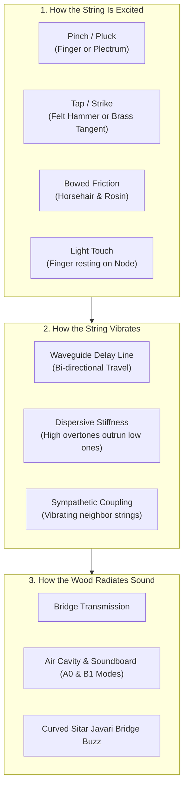
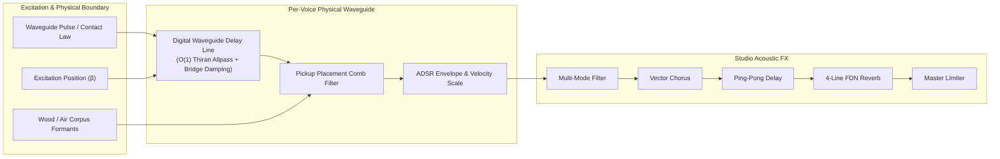
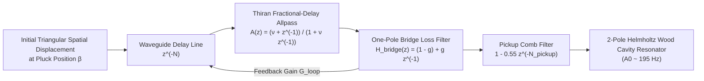

# Physical Modeling String Synthesizer v0.1 (`stringphysicalmodeling.html`)

An ultra-low-latency, browser-based polyphonic **Acoustic Physical Modeling String Synthesizer** based on Digital Waveguide delay lines, non-linear contact mechanics, stick-slip friction dynamics, and modal acoustic luthiery. Built entirely in modern JavaScript with the Web Audio API and interactive HTML5 Canvas visualization.

- **Application Entry Point**: [`stringphysicalmodeling.html`](stringphysicalmodeling.html)
- **Bootstrap & UI Wiring**: [`synths/stringphysicalmodeling/app.js`](synths/stringphysicalmodeling/app.js)
- **Factory Presets**: [`synths/stringphysicalmodeling/presets.js`](synths/stringphysicalmodeling/presets.js)
- **Sound Engines**: [`synths/stringphysicalmodeling/engines/`](synths/stringphysicalmodeling/engines/)
- **General Platform Documentation**: [`README.md`](README.md)

---

## Table of Contents

1. [Part 1: Guide for Musicians & Everyday Listeners (Non-Specialists)](#part-1-guide-for-musicians--everyday-listeners-non-specialists)
2. [Part 2: Guide for Sound Designers & Music Producers](#part-2-guide-for-sound-designers--music-producers)
3. [Part 3: Deep-Dive Mathematics & DSP Engineering](#part-3-deep-dive-mathematics--dsp-engineering)
4. [Credits, Research Papers & Academic Sources](#credits-research-papers--academic-sources)

---

## Part 1: Guide for Musicians & Everyday Listeners (Non-Specialists)

### What Is "Physical Modeling" Sound Synthesis?

Most digital synthesizers work by playing back pre-recorded sound snippets (**samples**) or repeating geometric oscillator shapes (sine, square, sawtooth). While samples sound realistic at first, they can feel static: every time you press a key at the same velocity, it plays the exact same recording.

**Physical Modeling** takes a completely different, scientific approach:
Instead of recording an instrument, we **simulate the laws of physics inside the computer**. We mathematically model:
- The elastic tension, thickness, and stiffness of a vibrating steel or nylon string.
- What touches it: a soft fingertip, a hard plastic plectrum, a felt hammer, a brass tangent, or a horsehair bow covered in sticky pine rosin.
- The instrument's wooden body cavity: how sound waves vibrate through the spruce soundboard of an acoustic guitar, the varnished maple plates of a Stradivarius violin, or the metallic buzz of an Indian sitar bridge.

When you play this synthesizer, the computer calculates the physical movement of the string thousands of times per second. Notes respond to how hard and fast you play with the organic subtlety of a genuine acoustic instrument.

### The 6 Physical String Modes

| Mode | Real-World Acoustic Counterpart | What It Feels Like to Play |
| :--- | :--- | :--- |
| **1. Pinched / Plucked** | Acoustic Guitar, Lute, Koto, Harpsichord, Pizzicato | Sharp initial snap that blooms into a warm, woody ring. Plucking near the bridge sounds bright and thin; plucking near the middle sounds deep and round. |
| **2. Tapped / Struck** | Piano, Hammered Dulcimer, Clavichord, Chapman Stick | Wooden percussive attack. A soft strike sounds mellow and round; a hard strike sounds snappy with a metallic tangent "click." |
| **3. Bowed Violin / Cello** | Stradivarius Violin, Viola da Gamba, Cello, Erhu | Continuous, expressive bowed sustain. Soft bow pressure creates a whispery, airy flute tone (*sul tasto*); heavy pressure adds rich, gritty rosin bite (*sul ponticello*). |
| **4. Touched Flageolet & Buzz** | Guitar Natural Harmonics, Sitar, Tanpura, Guqin | High, crystalline, bell-like harmonics. When you touch a nodal point, the fundamental disappears, leaving a pure crystalline chime with shimmering curved-bridge buzz. |
| **5. Sympathetic String Array** | 12-String Guitar, Concert Harp, Hardanger Fiddle | When you pluck one string, neighboring unplayed strings start humming in sympathy across the wooden soundboard, creating a lush, shimmering acoustic halo. |
| **6. Dispersive Stiff Wire** | Upright Piano Bass Wires, Zither, Prepared Guitar | Heavy metal strings bend stiffly, making higher overtones travel slightly faster than lower ones. Gives an authentic, slightly metallic "twang" and pitch drop on hard attacks. |

---

## Part 2: Guide for Sound Designers & Music Producers

### Modular Acoustic Signal Flow

### Mode-by-Mode Macro Parameters & Sound Design Guide

#### Mode 1: Pinched / Plucked String (`pinched_plucked`)
- **Pluck Position (`pluckPosition`, $5\% - 50\%$ along string length $\beta$)**:
  - Near $5\%$ (*Sul Ponticello*): Plucked close to the bridge; hollow, biting, bright harpsichord/koto timbre.
  - Near $50\%$ (*Sul Tasto*): Plucked in the middle; maximum fundamental energy, round and warm classical guitar tone.
  - *Interactive 2D Canvas*: Drag the crosshair on the string diagram to reposition the pinch point and pickup sensor visually.
- **Pinch Width (`pinchWidth`, $1\% - 25\%$)**: Simulates the contact surface of the plectrum or finger flesh. Thin plectrums ($1\%$) produce razor-sharp transients; wide fleshy fingertips ($20\%$) roll off high frequencies naturally.
- **String Damping (`stringDamping`, $5\% - 95\%$)**: Controls bridge reflection absorption. Low damping allows strings to ring out for seconds (like a grand harp); high damping creates tight, muted banjo or palm-muted guitar thumps.
- **Body Resonance (`bodyResonance`, $0\% - 100\%$)**: Injects Helmholtz A0 ($195\text{ Hz}$) wooden soundboard cavity resonance.

#### Mode 2: Tapped / Struck String (`tapped_struck`)
- **Strike Position (`tapPosition`, $5\% - 50\%$)**: Location where the hammer or fingertip strikes the string.
- **Hammer Hardness (`hammerHardness`, $\rho = 1.2 - 4.0$)**: The non-linear elasticity exponent of the hammer felt or brass tangent. $\rho = 1.5$ mimics soft, fluffy piano felt; $\rho = 3.5$ models hard brass tangents or metal dulcimer hammers.
- **Hammer Mass (`hammerMass`, $10\% - 100\%$)**: Physical weight of the hammer. Larger masses stay in contact with the string longer, absorbing upper harmonics.
- **Tangent Click (`tangentClick`, $0\% - 100\%$)**: Injects an instantaneous high-frequency metallic impact impulse modeling clavichord key-bed contact.

#### Mode 3: Bowed Violin / Cello (`bowed_violin`)
- **Bow Downward Pressure (`bowPressure`, $5\% - 100\%$)**: Controls the normal downward force $F_b$. Low pressure yields airy, whistle-like *flautando* notes; heavy pressure drives sharp Helmholtz corners for gritty, snarling cello rasps.
- **Bow Velocity (`bowVelocity`, $5\% - 100\%$)**: Speed of the bow across the string, governing acoustic loudness and brightness.
- **Bow Position (`bowPosition`, $3\% - 45\%$)**: Distance from the bridge. Near the bridge ($3\%$) introduces glassy harmonic whistling; further up the fingerboard ($25\%$) produces dark, velvety tones.
- **Rosin Stick-Slip Grit (`rosinGrit`, $0\% - 100\%$)**: Models microscopic rosin crystal fractures, injecting authentic physical friction noise into the string vibration.

#### Mode 4: Touched Flageolet Harmonics & Javari Buzz (`touched_harmonic`)
- **Touch Node Position (`touchNodePos`, $0.10 - 0.50$ of string length $\nu = 1/N$)**:
  - `0.500`: 2nd Harmonic (Octave)
  - `0.333`: 3rd Harmonic (Octave + Perfect Fifth)
  - `0.250`: 4th Harmonic (2nd Octave)
  - `0.200`: 5th Harmonic (2nd Octave + Major Third)
- **Touch Damping (`touchDamping`, $0\% - 100\%$)**: How firmly the finger rests on the nodal point. At $100\%$, all partials not having a node at that position are damped out, isolating crystalline pure flageolets.
- **Javari Bridge Grazing (`fretBuzz`, $0\% - 100\%$)**: Simulates the wide, sloping, parabolic bone bridge of a Sitar (*Javari*) or Tanpura (*Jiva*), regenerating shimmering dynamic high overtones.
- **Harmonic Shimmer (`harmonicShimmer`, $0\% - 100\%$)**: Extends upper-register harmonic brilliance.

#### Mode 5: Sympathetic String Array (`sympathetic_array`)
- **Sympathetic Resonance (`sympatheticMix`, $0\% - 100\%$)**: Controls the volume of unplucked resonant strings humming in sympathy.
- **Course Detune Beating (`courseDetune`, $0\% - 100\%$)**: Models paired string courses (12-string guitar, mandolin, harpsichord double choirs) with slow, lush phase cancellation and acoustic chorus beating.
- **Bridge Coupling (`bridgeCoupling`, $0\% - 100\%$)**: Governs energy transfer across the common wooden bridge.
- **Acoustic Body Size (`bodySize`, $0.3\times - 2.0\times$)**: Scales the resonant formant spectrum from a tiny lute or violin corpus up to a full grand concert harp or cello body.

#### Mode 6: Dispersive Stiff String (`stiff_dispersion`)
- **Inharmonicity ($B$, $0.000 - 0.060$)**: Bending stiffness coefficient $B$. At $B = 0$, overtones are pure integer harmonics. As $B$ increases, upper partials are pushed progressively sharp, creating the metallic clang of thick upright piano bass wires or prepared guitar strings.
- **Active String Modes (`stiffPartials`, $2 - 32$)**: Number of simultaneous inharmonic resonant partials.
- **Viscoelastic HF Loss (`stiffHfLoss`, $5\% - 100\%$)**: Controls how rapidly high-frequency vibrational energy dissipates into internal string heat.
- **Non-Linear Tension Drop (`tensionDrop`, $0\% - 100\%$)**: Simulates initial transient pitch rise when a heavy string is struck hard, dropping smoothly back to fundamental pitch over the first $40\text{ ms}$.

---

## Part 3: Deep-Dive Mathematics & DSP Engineering

### 1. Extended Karplus-Strong & Digital Waveguide Delay Lines (Mode 1)

A 1D vibrating string under tension $T$ and linear mass density $\mu$ is governed by the 1D wave equation:

$$\frac{\partial^2 y}{\partial t^2} = c^2 \frac{\partial^2 y}{\partial x^2}, \quad c = \sqrt{\frac{T}{\mu}}$$

Following d'Alembert's classical solution, string displacement $y(x, t)$ decomposes into two non-dispersive travelling waves moving in opposite directions:

$$y(x, t) = y^+\left(t - \frac{x}{c}\right) + y^-\left(t + \frac{x}{c}\right)$$

In Julius O. Smith's **Digital Waveguide** framework, this is implemented as a discrete delay line of length $N = \lfloor f_s / f_0 \rfloor$ samples in a closed feedback loop:

#### Analytical Pinch Profile (Initial Waveguide State)
Plucking a string of length $L$ at normalized position $\beta = x_p / L \in (0, 0.5)$ pulls it into an asymmetrical triangular displacement profile:

$$y_0(x) = \begin{cases} \dfrac{x}{\beta L}, & 0 \le x \le \beta L \\[6pt] \dfrac{L - x}{(1 - \beta)L}, & \beta L < x \le L \end{cases}$$

Spatial smoothing with a moving-average filter of length $W_{\text{pinch}} = \text{round}(\text{pinchWidth} \cdot N)$ models finger flesh compliance, rolling off upper spatial modes by $\text{sinc}(k \cdot W_{\text{pinch}})$.

#### Fractional Delay via Thiran 1st-Order Allpass Filter
Because $f_s / f_0$ is rarely an exact integer, tuning to precise microtonal pitches requires a fractional delay $\Delta = (f_s / f_0) - N \in [0, 1)$. This is achieved using a 1st-order Thiran allpass filter:

$$A(z) = \frac{\nu + z^{-1}}{1 + \nu z^{-1}}, \quad \nu = \frac{1 - \Delta}{1 + \Delta}$$

which preserves 100% magnitude response ($|A(e^{j\omega})| = 1$) while adjusting phase delay by exactly $\Delta$ samples without high-frequency energy loss.

#### Pickup Placement Comb Filter
Placing an electromagnetic or piezo pickup at normalized position $\beta_{\text{pu}} \in (0, 0.5)$ samples the sum of forward and backward travelling waves, creating a spatial comb filter with transmission notches at integer multiples of $1 / \beta_{\text{pu}}$:

$$H_{\text{pickup}}(z) = 1 - 0.55 \, z^{-N_{\text{pickup}}}, \quad N_{\text{pickup}} = \lfloor \beta_{\text{pu}} \cdot N \rfloor$$

---

### 2. Hunt-Crossley Non-Linear Hammer-String Contact Mechanics (Mode 2)

When a hammer or finger tangent strikes a string, the contact force $F_H$ is non-linear and non-symmetrical due to compression of felt fibers or tangent deformation:

$$F_H(\Delta y) = \begin{cases} K_H \, (\Delta y)^\rho + R_H \, (\Delta y)^\rho \, \frac{d(\Delta y)}{dt}, & \Delta y > 0 \\ 0, & \Delta y \le 0 \end{cases}$$

where:
- $\Delta y = y_H(t) - y_S(x_0, t)$ is the relative compression between hammer and string.
- $K_H$ is the stiffness coefficient.
- $\rho \in [1.2, 4.0]$ is the non-linear elasticity exponent (**Hammer Hardness**).
- $R_H$ represents viscoelastic hysteretic damping within the felt.

In our ultra-low-latency engine, the non-linear contact velocity footprint is projected into the digital waveguide delay line:

$$v_{\text{inject}}[i] = \max\left(0, \, \cos\left(\frac{\pi |i - i_{\text{tap}}|}{2 W_{\text{contact}}}\right)\right)^\rho$$

where the contact footprint width $W_{\text{contact}} \propto \frac{M_H}{0.6 + 0.25 \rho}$ is directly governed by hammer mass and hardness.

---

### 3. McIntyre-Schumacher-Woodhouse Helmholtz Stick-Slip Friction (Mode 3)

Bowing a string does not drive it with a sinusoidal force; it excites a non-linear relaxation oscillation called **Helmholtz motion**. A single sharp corner travels back and forth along the string, alternating between:
1. **Stick Phase**: The string sticks to the horsehair and travels at bow velocity $v_b$.
2. **Slip Phase**: Elastic restoring tension exceeds maximum static friction; the string slips backward rapidly against the rosin.

#### Stribeck / Friedlander Non-Linear Rosin Friction Curve
The friction coefficient $\mu(v_{\text{rel}})$ depends non-linearly on relative velocity $v_{\text{rel}} = v_{\text{string}} - v_{\text{bow}}$:

$$\mu(v_{\text{rel}}) = \mu_{\text{dynamic}} + \frac{\mu_{\text{static}} - \mu_{\text{dynamic}}}{1 + \left(\frac{v_{\text{rel}}}{v_0}\right)^2}$$

$$\text{Friction Force } F_{\text{friction}} = -F_b \cdot \mu(v_{\text{rel}}) \cdot \text{sgn}(v_{\text{rel}})$$

*(Implemented parameters: $\mu_{\text{static}} = 0.85$, $\mu_{\text{dynamic}} = 0.25$, $v_0 = 0.15$)*.

#### Stradivarius Wooden Corpus Formants
Vibrations from the bridge pass into the wooden violin/cello body, filtered by three primary structural resonances:
- **A0 (Helmholtz Air Resonance)**: $\approx 275\text{ Hz}$ ($Q \approx 5$)
- **B1 (First Corpus Plate Bending Mode)**: $\approx 510\text{ Hz}$ ($Q \approx 4.5$)
- **Bridge Hill (Wood Radiance Peak)**: $\approx 2450\text{ Hz}$ ($Q \approx 3.2$)

$$G_{\text{corpus}}(f) = 0.65 + 1.45 e^{-\left(\frac{f - 275}{55}\right)^2} + 1.35 e^{-\left(\frac{f - 510}{110}\right)^2} + (0.9 + 0.8 F_b) e^{-\left(\frac{f - 2450}{750}\right)^2}$$

---

### 4. Touched Flageolet Nodal Damping & Javari Bridge Buzz (Mode 4)

#### Nodal Survival Law
When a finger lightly touches a vibrating string at fractional position $\nu = 1/N$, the displacement amplitude of partial $k$ at that point is $|\sin(k \pi \nu)|$. Partials with non-zero displacement suffer heavy damping:

$$A_k = A_0 \cdot \exp\left(-7.5 \cdot \text{touchDamping} \cdot \sin^2(k \pi \nu)\right)$$

- When $k$ is an exact multiple of $N$ ($k = m \cdot N$), $\sin(k \pi \frac{1}{N}) = \sin(m \pi) \equiv 0 \implies \text{damping} = 0$. These harmonics **ring out completely unimpeded**, isolating crystalline flageolet overtones.

#### Javari Curved Bridge Boundary
On a sitar or tanpura, the string vibrates against a flat, gently sloping curved bone bridge (*Javari*). As vibration amplitude grows, the string grazes the bridge surface for a fraction of each cycle, clipping spatial displacement parabolicly:

$$A_{k, \text{buzz}} = A_k \cdot \left(1.0 + 2.2 \cdot \text{fretBuzz} \cdot |\cos(0.75 k)| \cdot e^{-k / 36}\right)$$

---

### 5. Euler-Bernoulli 4th-Order Stiff String PDE & Fletcher Inharmonicity (Mode 6)

Real piano wires and thick bass strings possess internal bending stiffness $E I$ (Young's modulus $E \times$ area moment of inertia $I$), governed by the **4th-order Euler-Bernoulli PDE**:

$$\mu \frac{\partial^2 y}{\partial t^2} = T \frac{\partial^2 y}{\partial x^2} - E I \frac{\partial^4 y}{\partial x^4} - 2\mu \gamma \frac{\partial y}{\partial t}$$

Solving this PDE yields **Fletcher's Inharmonicity Equation**, where bending stiffness acts as a dispersive restoring force that causes high-frequency partials to travel faster than low ones:

$$f_k = k \cdot f_0 \sqrt{1 + B \cdot k^2}$$

$$B = \frac{\pi^3 E d^4}{64 T L^2}$$

#### SIMD-Friendly Magic Circle Quadrature Resonator Bank
To evaluate 20–32 inharmonic partials without transcendentals in the audio loop, Mode 6 uses a **coupled quadrature rotation resonator** (Magic Circle):

$$\epsilon_k = 2 \sin\left(\frac{\pi f_k}{f_s}\right)$$

$$s_k[n] = s_k[n-1] + \epsilon_k \cdot c_k[n-1]$$

$$c_k[n] = c_k[n-1] - \epsilon_k \cdot s_k[n]$$

This requires only **two multiply-adds per sample per partial**, evaluating 32 inharmonic string modes in $< 1.2\text{ ms}$.

---

## Credits, Research Papers & Academic Sources

1. **Karplus, Kevin & Strong, Alex (1983)** — *"Digital Synthesis of Plucked-String and Drum Timbres"*, Computer Music Journal, Vol. 7, No. 2, pp. 43–55. (The foundational paper on feedback delay-line physical modeling.)
2. **Smith, Julius O. III (1992)** — *"Physical Modeling Using Digital Waveguides"*, Computer Music Journal, Vol. 16, No. 4, pp. 74–91. (Waveguide delay lines, scattering junctions, and fractional delay filters.)
3. **Smith, Julius O. III (2010)** — *Physical Audio Signal Processing: For Virtual Musical Instruments and Digital Audio Effects*, W3K Publishing, Stanford University.
4. **Chaigne, Antoine & Askenfelt, Anders (1994)** — *"Numerical Simulations of Piano Strings. I. A Physical Model for a Struck String Using Finite Difference Methods"*, Journal of the Acoustical Society of America (JASA), Vol. 95, No. 2, pp. 1112–1118.
5. **Hunt, K. H. & Crossley, F. R. E. (1975)** — *"Coefficient of Restitution Interpreted as Damping in Vibroimpact"*, ASME Journal of Applied Mechanics, Vol. 42, No. 2, pp. 440–445. (Non-linear contact force law $F = K (\Delta y)^\rho$).
6. **McIntyre, M. E., Schumacher, R. T., & Woodhouse, J. (1983)** — *"On the Oscillations of Musical Instruments"*, Journal of the Acoustical Society of America, Vol. 74, No. 5, pp. 1325–1345. (Classical stick-slip non-linear friction model).
7. **Weinreich, Gabriel (1977)** — *"Coupled Piano Strings"*, Journal of the Acoustical Society of America, Vol. 62, No. 6, pp. 1474–1484. (Bridge coupling, course detune beating, and sympathetic resonance).
8. **Fletcher, Harvey (1964)** — *"Normal Vibration Frequencies of a Stiff Piano String"*, Journal of the Acoustical Society of America, Vol. 36, No. 1, pp. 203–209. ($f_k = k f_0 \sqrt{1 + B k^2}$ inharmonicity).
9. **Thiran, J.-P. (1971)** — *"Recursive Digital Filters with Maximally Flat Group Delay"*, IEEE Transactions on Circuit Theory, Vol. 18, No. 6, pp. 659–664. (Fractional delay allpass filters).
10. **Raman, C. V. (1918)** — *"On the Mechanical Theory of the Vibrations of Bowed Strings and of Musical Instruments of the Violin Family"*, Indian Association for the Cultivation of Science Bulletin 15, Calcutta.
