# Web Synthesizers Workstation

A modular, browser-based sound synthesis workstation built with modern JavaScript and the Web Audio API. The repository features three specialized polyphonic synthesizers sharing an extensible Web Audio DSP framework, hardware Web MIDI integration, studio effects, real-time visualizers, and lossless WAV recording.

---

## The Synthesizers

Each synthesizer runs as a standalone web application and has its own dedicated deep-dive documentation covering explanations for everyday listeners, sound designers, and DSP mathematicians:

| Synthesizer | Entry Point | Documentation | Description |
| :--- | :--- | :--- | :--- |
| **80s FM Piano Synth v0.1** | [`fmpianos.html`](fmpianos.html) | [**`README-fmpianos.md`**](README-fmpianos.md) | Musician-friendly 6-Operator Phase Modulation (FM) piano engine capturing the iconic crystalline electric pianos, bell chimes, barking reeds, and lush ballad stacks of the 1980s. |
| **Fractal Sound Engine V2** | [`fractalsynths.html`](fractalsynths.html) | [**`README-fractal.md`**](README-fractal.md) | Polyphonic synthesizer driven by mathematical fractals, strange attractor chaos theory (Lorenz, Rössler, Chua), optical image resynthesis, and Wolfram 1D cellular automata. |
| **Physical Modeling String Synthesizer v0.1** | [`stringphysicalmodeling.html`](stringphysicalmodeling.html) | [**`README-stringphysicalmodeling.md`**](README-stringphysicalmodeling.md) | Acoustic string acoustics engine modeling plucked waveguides, tapped/struck hammers, bowed violin stick-slip friction, flageolet nodes, sympathetic arrays, and dispersive stiff wires. |

---

## Shared Framework Architecture & Features

All three synthesizers share a unified, high-performance architecture located in `framework/`, `modules/`, `effects/`, and `visualizers/`:

```mermaid
flowchart LR
    subgraph Input_Stage ["Input & Sequencing"]
        MIDI["Web MIDI Controller<br/>(Velocity, Pitch Bend, CC#64)"]
        QW["Touch & QWERTY Keyboard<br/>(2 Octaves, Velocity-Sensitive)"]
        ARP["Generative Arpeggiator<br/>(Euclidean, Fibonacci, Thue-Morse)"]
        LFO["Modulation LFO<br/>(Sine, Tri, Saw, Square, fBm)"]
    end

    subgraph Voice_Stage ["Polyphonic Voice Matrix"]
        VM["PolyphonicVoiceManager<br/>(Up to 32 Voices, Voice Stealing)"]
        UNI["Super-Unison Detune Stack"]
        SUB["Dedicated Sub-Bass Core"]
        ENV["Per-Voice ADSR Envelope"]
    end

    subgraph Bus_Stage ["Shared AudioBus & FX Chain"]
        BUS["AudioBus (Native Node Routing)"]
        FLT["24dB Multi-Mode Filter"]
        DRV["Wavefolder & Saturation"]
        CHO["Vector Stereo Chorus"]
        DLY["Ping-Pong Stereo Delay"]
        REV["4-Line FDN Algorithmic Reverb"]
        LIM["Master Lookahead Limiter"]
    end

    subgraph Output_Stage ["Output & Diagnostics"]
        REC["Master WAV Audio Recorder"]
        VIZ["Real-Time Visualizer Suite"]
        DEST["Audio Destination (Speakers)"]
    end

    Input_Stage --> VM
    VM --> UNI --> SUB --> ENV --> BUS
    BUS --> FLT --> DRV --> CHO --> DLY --> REV --> LIM
    LIM --> DEST
    LIM --> REC
    LIM --> VIZ
```



### 1. Web Audio Processing (`AudioBus` & `PolyphonicVoiceManager`)
- **Zero-Copy Native Audio Graph**: Signals route directly on the browser's audio rendering thread:
  $$\text{Voice} \to \text{Detune/Unison} \to \text{ADSR Gain} \to \text{Filter} \to \text{Drive} \to \text{Chorus} \to \text{Delay} \to \text{Reverb} \to \text{Limiter} \to \text{Destination}$$
- **32-Voice Polyphony & Voice Stealing**: Automatically reallocates the oldest voice or voices released by the sustain pedal.
- **Portamento / Glide**: Logarithmic frequency glide between consecutive notes.
- **Master FX Bypass**: One-click toggle to bypass the entire effects rack and audition pure oscillator output.

### 2. Hardware Web MIDI Integration (`WebMIDIManager`)
Connect any class-compliant USB or Bluetooth MIDI keyboard via the **`🎹 Connect Web MIDI`** button:
- **Note On / Velocity**: 7-bit velocity ($1 - 127$) is shaped through an expressive intermediate exponential curve:
  $$v = 0.12 + 0.88 \cdot \left(\frac{v_{\text{midi}}}{127}\right)^{1.45}$$
  providing a wide $\sim 22\text{ dB}$ dynamic and timbral range while keeping soft *pianissimo* notes clearly audible.
- **Note Off**: Clean envelope release triggering.
- **Sustain Pedal (CC #64)**: Holds notes in a pending-release buffer until the damper pedal is released.
- **14-Bit Pitch Bend**: High-resolution $\pm 2$ semitone pitch modulation ($\pm 200\text{ cents}$).

### 3. Interactive Touch & QWERTY Keyboard (`PianoKeyboard`)
- **Vertical Velocity Sensitivity**: Clicking or tapping on keys responds to vertical position—softer near the top ($pp$), louder near the bottom ($ff$).
- **2-Octave QWERTY Keyboard Mapping**:
  - *Lower Octave*: `Z` (C), `S` (C#), `X` (D), `D` (D#), `C` (E), `V` (F), `G` (F#), `B` (G), `H` (G#), `N` (A), `J` (A#), `M` (B), `,` (C).
  - *Upper Octave*: `Q` (C), `2` (C#), `W` (D), `3` (D#), `E` (E), `R` (F), `5` (F#), `T` (G), `6` (G#), `Y` (A), `7` (A#), `U` (B), `I` (C).
- **Octave Transposition**: Shift octaves on the fly with the **`Oct -`** and **`Oct +`** buttons.

### 4. Lossless Master WAV Audio Recorder (`AudioRecorder`)
- Records directly from the master limiter output via `MediaStreamDestination`.
- One-click **`⏺️ Record Master WAV`** starts recording; clicking **`⏹️ Stop & Download WAV`** generates and downloads a clean 16-bit stereo `.wav` file immediately without cloud processing or external tools.

### 5. Preset Management & Patch Mutator (`PresetManager`)
- **Factory Presets**: Curated factory sound banks categorized by timbre.
- **Patch Mutation (`🎲 Mutate 25%`)**: Intelligent parameter randomization by $\pm 25\%$ around current knob values to quickly generate musical patch variations.
- **A/B State Comparison**: Save active settings into State A with **`💾 Save State A`** and toggle back with **`Audition State A`**.

### 6. Generative Fractal Arpeggiator (`ArpeggiatorModule`)
- **Traditional Modes**: Up, Down, Up/Down, Random.
- **Mathematical Sequences**:
  - **Euclidean $E(k, n)$**: Distributes $k$ pulses across $n$ steps using Euclid's GCD algorithm (e.g. $E(5, 8)$ Afro-Cuban bell patterns).
  - **Fibonacci**: Offsets derived from $F_n = F_{n-1} + F_{n-2} \bmod 12$.
  - **Thue-Morse**: Fair-sharing binary parity sequences.
- **Controls**: BPM ($40 - 240$), Gate Length ($10\% - 95\%$), Octave Span ($1 - 4$), and Musical Scale Quantizer (Chromatic, Major, Minor, Dorian, Pentatonic).

### 7. Real-Time Visualizer Suite (`VisualizerSuite`)
Hardware-accelerated HTML5 Canvas rendering at 60 FPS across 5 diagnostic tabs:
1. **3D Custom Primary Visualizer**: Engine-specific 3D view (3D Strange Attractor Orbits, 3D Vibrating Standing-Wave Ribbons, or 3D DX7 Operator Sideband Bars).
2. **FFT Waterfall Spectrogram**: Rolling frequency-time waterfall with glowing thermal colormaps.
3. **Goniometer / Vector Scope**: XY phase-space Lissajous patterns measuring stereo width and phase correlation.
4. **Harmonics Partials Bar**: Real-time discrete overtone spectrum analyzer ($1f$ to $32f$).
5. **Waveform Oscilloscope**: Time-domain oscilloscope with zero-crossing phase stabilization.

---

## Project Structure

```
├── fractalsynths.html                 # Entry Point: Fractal Sound Engine V2
├── stringphysicalmodeling.html        # Entry Point: Physical Modeling String Synth
├── fmpianos.html                      # Entry Point: 80s FM Piano Synth
├── README.md                          # General Workstation Documentation (this file)
├── README-fmpianos.md                 # Deep-Dive: 80s FM Piano Synth
├── README-fractal.md                  # Deep-Dive: Fractal Sound Engine V2
├── README-stringphysicalmodeling.md   # Deep-Dive: Physical Modeling String Synth
│
├── framework/                         # Shared Web Synthesizer Framework
│   ├── synth-framework.js             # Master lifecycle & 60 FPS animation coordinator
│   ├── audio-bus.js                   # High-efficiency zero-copy Web Audio bus routing
│   ├── voice-manager.js               # 32-voice polyphonic allocator & engine registry
│   ├── midi.js                        # Web MIDI manager (Note On/Off, CC#64, Pitch Bend)
│   ├── keyboard.js                    # Velocity-sensitive touch & QWERTY keyboard
│   ├── recorder.js                    # Master lossless WAV recorder & browser downloader
│   ├── preset-manager.js              # Preset loader, patch mutator & A/B comparator
│   ├── ui-controls.js                 # Precision SVG rotary knob controller
│   └── math-scales.js                 # Musical scales, tuning tables & math constants
│
├── modules/                           # Shared Per-Voice & Modulation Modules
│   ├── envelope.js                    # ADSR envelope generator with canvas preview
│   ├── detune.js                      # Super-Unison detune stack & sub-bass core
│   ├── lfo.js                         # Modulation LFO with dynamic target registration
│   └── arpeggiator.js                 # Traditional & fractal mathematical arpeggiator
│
├── effects/                           # Shared Studio Audio Effects Pipeline
│   ├── fx-engine.js                   # Effects pipeline master coordinator
│   ├── filter.js                      # 24dB/oct multi-mode filter (LP, HP, BP, Notch)
│   ├── wavefolder.js                  # Non-linear hyperbolic tangent wavefolder
│   ├── chorus.js                      # Multi-phase vector stereo chorus
│   ├── delay.js                       # Ping-Pong feedback delay
│   ├── reverb.js                      # 4-line Feedback Delay Network (FDN) reverb
│   └── limiter.js                     # Brickwall lookahead master dynamics limiter
│
├── visualizers/                       # Shared Real-Time 2D/3D Visualization Suite
│   ├── visualizer-suite.js            # 5-tab canvas visualizer suite
│   └── fractal-2d-canvas.js           # Interactive 2D complex plane renderer
│
├── synths/                            # Synthesizer Implementations & Sound Engines
│   ├── fractal/                       # Fractal Sound Engine V2 (app, presets, 6 engines)
│   ├── stringphysicalmodeling/        # Physical Modeling String Synth (app, presets, 6 engines)
│   └── fmpianos/                      # 80s FM Piano Synth (app, presets, 6 engines)
│
└── tests/                             # Automated Unit & Integration Test Suite
    ├── test-harness.js                # Web Audio API mock harness for Node.js
    ├── synth.test.js                  # Core synthesizer engine tests
    ├── modular-architecture.test.js   # Framework & module integration tests
    ├── string-synth.test.js           # Physical modeling string engine tests
    └── fm-pianos.test.js              # FM piano sound engine & preset tests
```

---

## How to Run the Synthesizers & Automated Tests

### 1. Running the Synthesizers Locally

No compilation, bundler, or build step is required. The synthesizers run in any modern web browser (Chrome, Firefox, Safari, Edge) that supports the Web Audio API and HTML5 Canvas:

- **Direct Drive Opening**:
  You can double-click and open `fractalsynths.html`, `stringphysicalmodeling.html`, or `fmpianos.html` directly from your local file system (`file://`).
- **Using a Local HTTP Server**:
  ```bash
  # Using Python 3
  python3 -m http.server 8080

  # Using Node.js (npx)
  npx serve .
  ```
  Then open in your browser:
  - `http://localhost:8080/fmpianos.html`
  - `http://localhost:8080/fractalsynths.html`
  - `http://localhost:8080/stringphysicalmodeling.html`

### 2. Running Automated Tests

The repository includes a comprehensive unit and integration test suite running on Node.js using its built-in test runner:

```bash
node --test tests/*.test.js
```

All 52 tests verify:
- Web Audio node creation, signal connection, and AudioBus routing.
- Polyphonic voice allocation, note-stealing, and sustain pedal behavior.
- MIDI velocity normalization curves and Pitch Bend calculations.
- All 18 sound engines across the 3 synthesizers (`fractal`, `stringphysicalmodeling`, `fmpianos`).
- Parameter initialization, knob bindings, and preset loading integrity.
